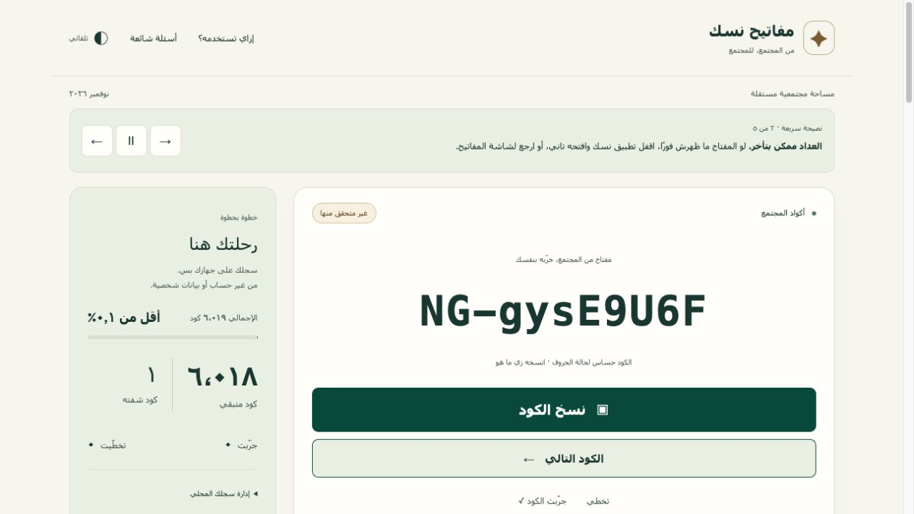

# مفاتيح نسك · Nusuk Codes Hub

<p dir="rtl" lang="ar">أداة مجتمعية مجانية لتصفح أكواد تحدي نسك والبحث عنها ونسخها، مع حفظ تقدمك على متصفحك. مشروع مستقل غير تابع لنسك أو وزارة الحج والعمرة السعودية. الأكواد غير متحقق من صلاحيتها.</p>

An open-source, community-driven companion for discovering and organizing Nusuk challenge codes.

**[Open Nusuk Codes Hub](https://nusuk.abdallahgaber.dev)** · [Contribute](CONTRIBUTING.md) · [Report a bug](https://github.com/abdallah-gaber/nusuk-codes/issues)

This is an independent community project, unaffiliated with Nusuk or the Saudi Ministry of Hajj and Umrah.

## Why it exists

Codes shared across social media are easy to lose and difficult to organize. This started as a personal tool to browse them without repetition and is shared freely so others can search, copy and track their own progress.

Copy a code, open the official Nusuk app, paste it into the code field and follow the app's verification flow.

## Features

- No-repeat browsing based on this browser's saved history.
- Quick copying that preserves exact capitalization.
- Local search with All, Unseen, Tried and Skipped filters.
- Personal progress, Tried/Skipped annotations and Undo.
- Local history export/import for manual transfer between browsers.
- Arabic-first RTL layout, responsive screens and light/dark themes.
- Official Nusuk sharing links. These may open without navigating or filling the code, so manual copy/paste is the recommended flow.



Existing interface screenshot from November 2026. Its displayed count predates the current dataset.

## Current season

The checked-in November 2026 snapshot contains **11,775 published, distinct code strings**, checked against the manifest and snapshot on November 5, 2026. Every entry remains **community-unverified**. Distinct strings do not establish working codes, successful redemption or eligibility. Consult the checked-in manifest for the latest release count. [Snapshot manifest](public/data/manifest.json)

## Principles

- **Free and open source.** The source code is MIT-licensed and contributions are welcome.
- **Privacy first.** Progress stays in browser storage with manual export/import. Production builds include Vercel Web Analytics for page views. Application tracking code sends no code values or local history.
- **Transparent provenance.** Public snapshots expose source domains and observation dates. Administrative provenance is maintained separately.
- **Safety and honest claims.** No login, passwords or OTPs are needed here. Syntax and publication approval never establish redemption.
- **Season awareness.** Codes and local history belong to a specific season. Old codes are not automatically carried forward.

## Seasons and future development

For each officially announced edition, review the challenge and rules, prepare a distinct season, collect and validate public community sources, and publish reviewed, integrity-checked snapshots. Preserve completed seasons and reassess possible code reuse using fresh evidence before owner approval. Multi-season support is a future implementation decision. [Season policy](docs/SEASONS.md)

## Contribute

Help with bugs, Arabic wording, accessibility, RTL layouts, tests or small improvements. Start with an Issue and send a focused PR. Read the contribution guide and community standards before participating. [CONTRIBUTING.md](CONTRIBUTING.md) · [Code of Conduct](CODE_OF_CONDUCT.md)

## Development

Use **Node.js 22.12+** and npm. Frontend tests also invoke **Python 3.13** for snapshot compatibility, without requiring Firebase credentials or the admin SDK.

```sh
git clone https://github.com/abdallah-gaber/nusuk-codes.git
cd nusuk-codes
npm ci
npm run dev
```

Open the local address printed by Vite. Run the frontend checks before a PR.

```sh
npm run lint
npm run typecheck
npm test
npm run build
```

Vite builds the static site into `dist/`. The public app loads integrity-checked CDN snapshots and keeps browsing local. Public visitors never access Firestore.

Technical details live in the architecture and provenance docs. Privileged administration has separate setup and runbooks, including additional Python and emulator checks. [Architecture](ARCHITECTURE.md) · [Provenance](DATA_PROVENANCE.md) · [Operations](OPERATIONS.md) · [Owner setup](SETUP_OWNER.md) · [Quick Import](docs/QUICK_IMPORT.md) · [Full admin runbook](docs/PHASE2A_ADMIN.md)

## License and disclaimer

Source code is available under the MIT License. This does not assert ownership of third-party community codes, official Nusuk branding or external data sources, or grant rights to them. [LICENSE](LICENSE)

No code redemption, reward or eligibility is guaranteed. The official Nusuk app and its current rules remain the source of truth for challenge participation.
