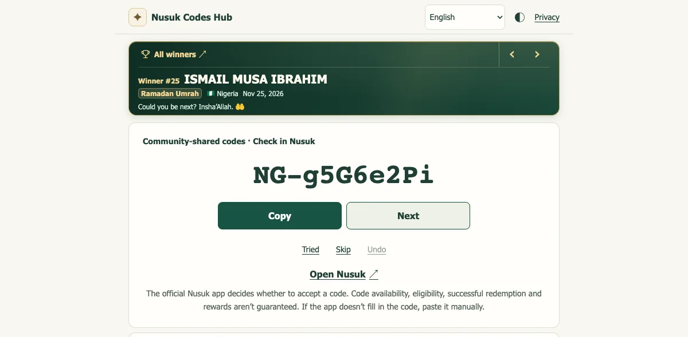
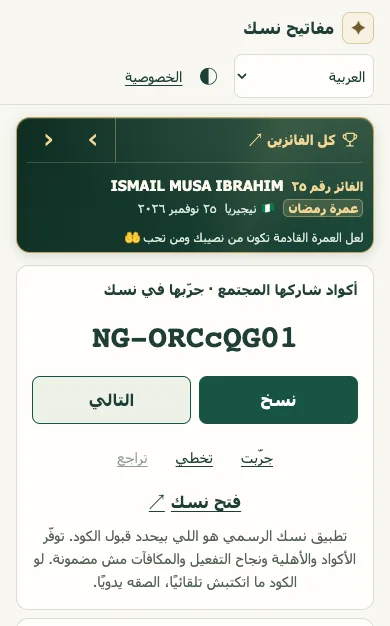

# Nusuk Codes Hub · مفاتيح نسك

A free, open-source community tool for finding Nusuk Challenge invitation codes and keeping track of the ones you’ve seen. Browse one code at a time, search the collection, and revisit published winner announcements without creating an account.

**[Open Nusuk Codes Hub](https://nusuk.abdallahgaber.dev/)** · [Contribute](CONTRIBUTING.md) · [Report an issue](https://github.com/abdallah-gaber/nusuk-codes/issues)

<p lang="ar" dir="rtl">أداة مجتمعية مجانية لتصفّح أكواد تحدي نسك والبحث فيها وحفظ تقدّمك على متصفّحك، مع أرشيف لإعلانات الفائزين.</p>

Nusuk Codes Hub is an independent community project, unaffiliated with Nusuk or the Saudi Ministry of Hajj and Umrah.

## Take a look

<table>
  <thead>
    <tr><th>English desktop</th><th>Arabic mobile</th></tr>
  </thead>
  <tbody>
    <tr>
      <td></td>
      <td></td>
    </tr>
  </tbody>
</table>

Captured on the live site on November 26, 2026. The collection and winner announcements change as releases are published.

## What you can do

- **Browse and search.** Step through community codes without repeating ones you’ve seen in this browser. Search locally and filter by All, Unseen, Tried, or Skipped.
- **Copy exact codes.** Copy and paste into the official Nusuk app. The official sharing link can also open Nusuk, with navigation and prefill varying by device.
- **Keep your place.** Mark codes tried or skipped, undo your last action, and export or import progress to move it between browsers.
- **Explore winner announcements.** The Winners Celebration Banner opens an archive of verified public announcements, with links back to the original sources. The archive may be incomplete.
- **Choose your language and theme.** Use [العربية](https://nusuk.abdallahgaber.dev/ar/), [English](https://nusuk.abdallahgaber.dev/en/), [Bahasa Indonesia](https://nusuk.abdallahgaber.dev/id/), or [اردو](https://nusuk.abdallahgaber.dev/ur/), with RTL support for Arabic and Urdu and light and dark themes.

## Data and privacy

The [snapshot manifest](public/data/manifest.json) records the current release’s season ID, publication timestamp, distinct code count, and integrity hash. Community codes are unverified for redemption. Nusuk determines code acceptance, eligibility, and rewards. See the [data provenance](DATA_PROVENANCE.md) and [season policy](docs/SEASONS.md).

Progress stays in browser storage. The site never asks for a Nusuk password or one-time code. Production includes Vercel Web Analytics for page views. Google Analytics, when configured, requires consent, which you can change in Analytics preferences. Application analytics events omit code values and local history. [Privacy and analytics details](docs/GROWTH_AND_ANALYTICS.md)

## Develop locally

The public site uses React, TypeScript, Vite, and Tailwind CSS, with static hosting on Vercel. The app verifies the CDN snapshot before browsing it locally. A separate Python admin pipeline uses Firestore for reviewed data and snapshot preparation. The public app never connects to Firestore. [Architecture](ARCHITECTURE.md) · [Operations](OPERATIONS.md) · [Owner setup](SETUP_OWNER.md)

Use Node.js 22.12+ and npm. The frontend tests also use Python 3.13 for a snapshot compatibility check. Firebase credentials are unnecessary for local frontend development.

```sh
git clone https://github.com/abdallah-gaber/nusuk-codes.git
cd nusuk-codes
npm ci
npm run dev
```

Open the address printed by Vite. Run these checks before opening a PR.

```sh
npm run lint
npm run typecheck
npm test
npm run build
```

The production build goes to `dist/`. For administrative work, follow the [quick import guide](docs/QUICK_IMPORT.md) or the [full admin runbook](docs/PHASE2A_ADMIN.md).

## Contributing and license

Bug reports, translation fixes, accessibility improvements, and focused pull requests are welcome. See the [contribution guide](CONTRIBUTING.md), [code of conduct](CODE_OF_CONDUCT.md), and [issue tracker](https://github.com/abdallah-gaber/nusuk-codes/issues).

The source code is [MIT-licensed](LICENSE). Third-party community codes, Nusuk branding, and external source material retain their own rights.
