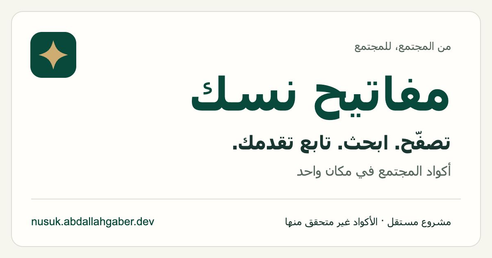

# Content and sharing polish

## Audit and changes

Production was inspected at desktop and 320px widths before editing. The initial-source paragraph described only the starter data. The empty state said “confirmed codes”, the no-repeat tip confused tried codes with seen codes, and the season label was fixed text.

- `src/main.tsx` now describes public community provenance without a fixed count or observation date. Dynamic source and observation fields are preserved and distinguished from creation, publication and redemption dates. Progress explicitly represents local browsing.
- `src/presentation.ts` formats the validated manifest's dataset month/year and release date in Arabic with UTC dates and unavailable-data fallbacks. Loading has a separate season message. This does not activate future seasons or change season validation.
- Freshness uses the actual snapshot generation timestamp, labels cached data as cached, and keeps the original timestamp. The existing seven-day warning now reevaluates every minute while a tab remains open.
- `src/TipsTicker.tsx` explains that the main browser avoids previously seen entries while search can revisit them. FAQs clarify that previous-season codes are not automatically carried forward.
- `index.html` supplies a static Arabic title/description, canonical URL, Open Graph and X large-image tags, icons and minimal WebSite JSON-LD. These avoid dataset counts, challenge dates, ratings and redemption claims.
- Robots allows crawling and references a one-URL sitemap. Hash anchors are sections of the same page, not additional routes. No invented sitemap modification date is supplied.

Identity, disclaimer and general usage instructions remain static because they do not depend on a dataset release. Month/year labels describe the dataset identifier, not official challenge dates. Official terms and the Nusuk app remain authoritative.

## Assets and browser review

The share image is a real browser rendering of the committed SVG source, using the site's colors, Arabic system-font styling and abstract star identity. It contains no sample codes or counts. The JPEG is 1200 × 630; the Apple icon is 180 × 180. The share image was inspected at full size and 600 × 315. The browser's minimum viewport width required cropping equal blank side margins from the icon capture to retain its square artwork.

Desktop light and mobile dark views were checked against the local production build. At the 320px viewport, the page's scroll width equaled its 305px available content width after the browser scrollbar. No redesign or layout change was needed.

Case-insensitive search returned the exact-case `NG-000CjNE0`. Copying preserved that capitalization and left the current code and progress unchanged. Skip moved to a different code and increased the skipped counter; Undo restored both. Keyboard-accessible native search/filter controls and existing state/history behavior remain in place.

Screenshots show the built app with the existing dataset. [Desktop](content-polish-desktop.jpg) · [Mobile provenance](content-polish-mobile-320.jpg)

## Validation and limits

ESLint, TypeScript, all 27 frontend tests and the production build passed. Tests cover missing/malformed labels, UTC release/observation dates, static crawler metadata and asset references, original cached release timestamps, and existing no-repeat/history behavior.

The built HTML was parsed for metadata and checked without JavaScript over local HTTP. Social-image and icon paths returned HTTP 200 with image/jpeg, image/png and image/svg+xml respectively. Robots returned text/plain and sitemap returned valid text/xml. XML contents, actual image dimensions, canonical/image URLs and the existing snapshot checksum/count were checked. No application/admin dependency, snapshot, publication or deployment configuration changed.

The initial HTML contains metadata and a noscript explanation, with an empty React root. Detailed browser content requires JavaScript. This does not establish complete search indexing or guarantee any platform's card rendering. Platform caches and live image responses require checking after an owner-approved deployment. Browser offline/error injection was not performed; mocked CDN/cache/error tests passed.

## Proposed repository settings

Repository settings were read and left for owner review. The description is currently empty, the website is configured, and only the nusuk topic is present.

- Description — Arabic-first community code browser for Nusuk challenges, with local search and personal progress. Independent; codes are unverified.
- Topics — nusuk, arabic, rtl, react, typescript, vite, community, open-source
- Website — https://nusuk.abdallahgaber.dev/
- Social Preview — reuse `public/social-preview.jpg`, uploaded through GitHub's repository settings.

After approving and deploying this PR, check the public social image and refresh social-platform caches as needed. No deployment or settings update was performed by this task.

Metadata follows the Open Graph fields and uses a standard summary_large_image card. [Open Graph protocol](https://ogp.me/)
